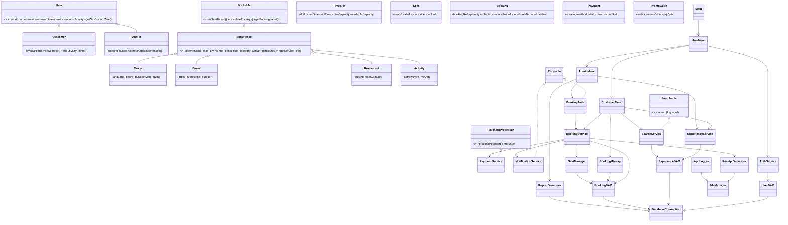

# Class Diagram and Class-by-Class Reference

## 1. Class diagram (Mermaid - renders on GitHub / VS Code)



## 2. Text dependency diagram

```
Main
 +-- UserMenu --> CustomerMenu, AdminMenu, AuthService, ExperienceService
 |     CustomerMenu --> ExperienceService, SearchService, BookingService, BookingHistory, SeatManager, ApiService
 |     AdminMenu    --> ExperienceService, BookingService, SeatManager, ReportGenerator, BookingTask
 +-- Services:  AuthService->UserDAO | ExperienceService, SearchService->ExperienceDAO
 |              BookingService->BookingDAO, SeatManager, PaymentService, ReceiptGenerator, NotificationService
 |              BookingHistory->BookingDAO, FileManager
 +-- DAOs:      UserDAO, ExperienceDAO, BookingDAO -> DatabaseConnection -> MySQL
 +-- Utilities: FileManager, AppLogger, InputHelper, ConsoleView, UserSession, UserValidator
```

## 3. The 32 core classes (assignment list)

Legend: **A** attributes, **C** constructors, **M** key methods, **OOP** concepts, **DB** database interaction.

### Member 1 - User Management and Authentication

| # | Class | Purpose and key details |
|---|---|---|
| 1 | `model.User` | Abstract base of all users. **A** userId, name, email, passwordHash, salt, phone, role, city. **C** default, full, short (chains with `this(...)`). **M** getters/setters, abstract `getDashboardTitle()`. **OOP** abstraction, encapsulation, constructor chaining, `this`. |
| 2 | `model.Customer` | Customer with loyaltyPoints. Overrides `getDashboardTitle()`, `viewProfile()`. **OOP** inheritance, overriding. |
| 3 | `model.Admin` | Admin with employeeCode. `canManageExperiences()`. **OOP** inheritance, runtime polymorphism (`User u = new Admin(...)`). |
| 4 | `service.AuthService` | `register`, `login`, `logout`, `updateProfile`, `refreshCurrentUser`, static `hashPassword/verifyPassword/generateSalt` (SHA-256 + random salt), `seedDefaultUsers`. Throws `InvalidLoginException`, `InvalidInputException`. Same error text for unknown email and wrong password. |
| 5 | `dao.UserDAO` | `insertUser`, `findByEmail`, `findById`, `getAllCustomers`, `updateProfile`. **DB** INSERT / SELECT / UPDATE with `PreparedStatement`, try-with-resources; maps rows to `Customer` or `Admin`. |
| 6 | `utility.UserSession` | Static current user; `login/logout/isAdmin/isLoggedIn`. **OOP** static members, role-based access. |
| 7 | `utility.UserValidator` | Static regex validators for name, email, phone, password; overloaded `validate(...)`. |
| 8 | `menu.UserMenu` | Main menu, registration and login flows, guest browsing; hands over to Customer/Admin menus. |

### Member 2 - Entertainment and Experience Management

| # | Class | Purpose and key details |
|---|---|---|
| 9 | `model.Experience` | Abstract base implementing `Bookable`. Abstract `getDetails()`; `getServiceFee()` (overridable). |
| 10 | `model.Movie` | Seat based; `calculatePrice(qty)` and overload `calculatePrice(qty, multiplier)`. |
| 11 | `model.Event` | Seat based, outdoor flag, overrides `getServiceFee()` (5%). |
| 12 | `model.Restaurant` | Capacity based; price per guest. |
| 13 | `model.Activity` | Capacity based; 10% group discount for 4+ participants. |
| 14 | `dao.ExperienceDAO` | CRUD over `experiences` + child table inside one transaction, slot and seat creation, `LEFT JOIN` query that builds the right subclass. **DB** INSERT/SELECT/UPDATE/DELETE, JOIN, commit/rollback. Soft-deletes an experience that already has bookings. |
| 15 | `service.ExperienceService` | Validation and admin-only enforcement; overloaded `addSlot(...)` (capacity vs rows x seats). |
| 16 | `service.SearchService` | Implements `Searchable`; overloaded `search(keyword)`, `search(category, city)`, `search(min, max)`; sorting with `Comparator`. |

### Member 3 - Booking and Payment

| # | Class | Purpose and key details |
|---|---|---|
| 17 | `model.Booking` | Booking entity with price breakdown, status, seats. |
| 18 | `model.Seat` | Seat entity; chained constructors; `equals/hashCode`. |
| 19 | `service.SeatManager` | Seat map display, label parsing (LinkedHashSet), `resolveSeats`, per-slot lock objects in a `ConcurrentHashMap`. |
| 20 | `dao.BookingDAO` | `createBooking` (one transaction: lock seats `FOR UPDATE`, check, reduce capacity, promo, insert booking, booking_seats, payment, loyalty; commit/rollback), `cancelBooking`, `findSeats`, `findByUser`, `findAll`, `findById`, `findPromo`. |
| 21 | `service.BookingService` | `createDraft`, `confirmBooking`, `cancelBooking`; refunds the simulated payment if the DB rejects the booking. |
| 22 | `model.Payment` | Payment record. |
| 23 | `service.PaymentService` | Implements `PaymentProcessor`; simulated card/UPI/wallet, deterministic and random failures, `refund`; overloaded `processPayment`. |
| 24 | `service.BookingHistory` | History, tiered refund policy (`getRefundPercent`, `calculateRefund`, `isCancellable`), CSV export. |

### Member 4 - System Integration and Utilities

| # | Class | Purpose and key details |
|---|---|---|
| 25 | `Main` | Wires every object (manual dependency injection), checks DB connection, starts/stops background threads, handles end of input. |
| 26 | `database.DatabaseConnection` | `DriverManager` connection, config from env > file > default, `testConnection`, rollback/close helpers, constraint-violation test. |
| 27 | `utility.FileManager` | `File`, `FileReader/FileWriter`, `BufferedReader/Writer`, `Files`, `Path`; ensure folders, write, append (synchronized), read, properties. |
| 28 | `utility.ReceiptGenerator` | Builds and writes `receipts/BOOKING_<ref>.txt` (try-with-resources). |
| 29 | `threading.NotificationService` | `Runnable` consumer thread with a `BlockingQueue`; prints and logs notifications without blocking the menu. |
| 30 | `threading.BookingTask` | `Runnable` simulating one customer; `runConcurrently` uses `ExecutorService` + `CountDownLatch`. |
| 31 | `api.ApiService` | `HttpClient` call to OpenWeatherMap, timeout, status handling, regex parsing, graceful fallback. |
| 32 | `utility.ReportGenerator` | JOIN + GROUP BY reports (revenue, bookings per experience, occupancy) saved to `reports/`. |

## 4. Additional types (beyond the 32)

| Type | Owner | Purpose |
|---|---|---|
| `model.Bookable`, `service.Searchable`, `service.PaymentProcessor` | M2, M2, M3 | Interfaces |
| 6 custom exceptions | M1 (`InvalidLoginException`, `InvalidInputException`), M2 (`DatabaseOperationException`), M3 (`SeatAlreadyBookedException`, `BookingNotFoundException`, `PaymentFailedException`) | Custom exception hierarchy |
| `model.TimeSlot` | M2 | A showing / session |
| `model.PromoCode` | M3 | Discount code |
| `menu.CustomerMenu` | M3 | Customer CLI (booking workflow) |
| `menu.AdminMenu` | M2 | Admin CLI |
| `utility.InputHelper`, `utility.ConsoleView`, `utility.AppLogger` | M4 | Safe input, table printing, background logger |

Total: 32 core + 3 interfaces + 6 exceptions + 7 helpers = **48 files**.

## 5. Where each OOP concept appears

| Concept | Where |
|---|---|
| Encapsulation | Private fields + getters/setters in every model class |
| Inheritance | `User` -> `Customer`, `Admin`; `Experience` -> `Movie`, `Event`, `Restaurant`, `Activity` |
| Overriding / runtime polymorphism | `getDashboardTitle()`, `getDetails()`, `calculatePrice()`, `getServiceFee()`, `isSeatBased()`; a `List<Experience>` holds mixed types and `BookingService` calls them without knowing the subtype |
| Overloading | `Movie.calculatePrice`, `SearchService.search` (3 versions), `ExperienceService.addSlot` (2), `PaymentService.processPayment` (2), `UserValidator.validate` (2), `InputHelper.readInt` (2) |
| Abstraction | abstract `User`, abstract `Experience`, abstract methods |
| Interfaces | `Bookable` (Experience), `Searchable` (SearchService), `PaymentProcessor` (PaymentService), `Runnable` (BookingTask, NotificationService) |
| Constructors / chaining | `User`/`Customer`/`Admin`, `Movie`/`Event`/..., `Seat` |
| static / this | `UserSession`, `UserValidator`, `FileManager`, `AppLogger`, `SeatManager.getLock`; `this.x = x` throughout |
