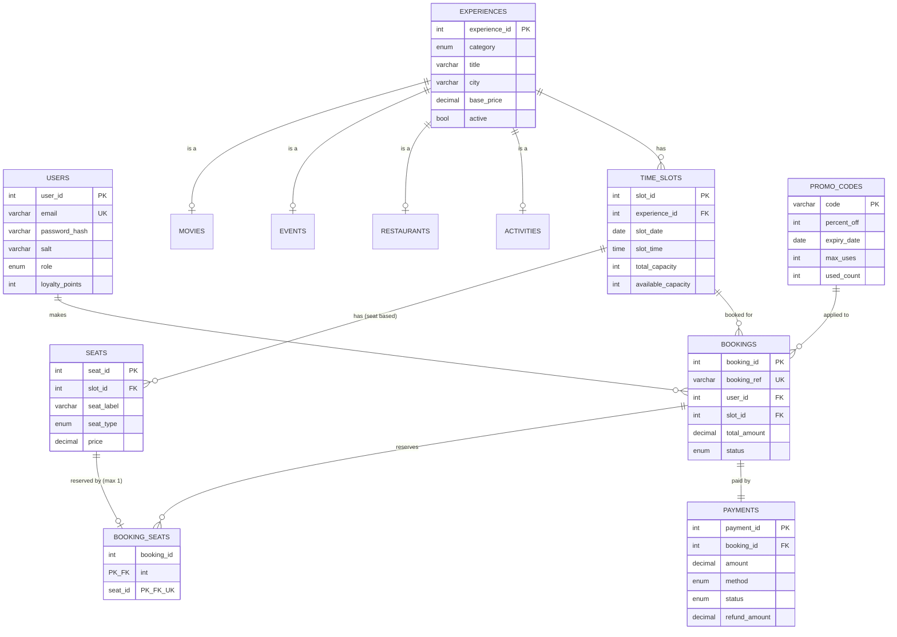

# Database Design (`urbanvibe_db`)

MySQL 8 / InnoDB. Full script: `database/schema.sql`.

## ER diagram

## Tables

| Table | Purpose | Notable constraints |
|---|---|---|
| users | customers and admins | `UNIQUE(email)`, `CHECK(loyalty_points >= 0)`, role ENUM |
| experiences | parent row for every bookable thing | `CHECK(base_price >= 0)`, category ENUM |
| movies / events / restaurants / activities | category details (1-to-1 with experiences) | PK = FK to experiences, `ON DELETE CASCADE`, CHECKs |
| time_slots | a showing/session with capacity | `UNIQUE(experience_id, slot_date, slot_time)`, `CHECK(0 <= available_capacity <= total_capacity)` |
| seats | seat map for seat-based slots | `UNIQUE(slot_id, seat_label)` |
| bookings | one row per booking | `UNIQUE(booking_ref)`, FKs to users and time_slots, `CHECK(quantity > 0)` |
| booking_seats | which seats a booking holds | **`UNIQUE(seat_id)`** - a seat can be in only one booking |
| payments | payment and refund record | FK to bookings, status SUCCESS/FAILED/REFUNDED |
| promo_codes | discount codes | `CHECK(percent_off BETWEEN 1 AND 90)` |

## How double booking is prevented

1. `BookingDAO.createBooking` runs in a transaction (`READ COMMITTED`).
2. It executes `SELECT seat_id FROM seats WHERE slot_id=? AND seat_label IN (...) FOR UPDATE`. A second transaction asking for the same seats **waits** here.
3. It checks `booking_seats` (now showing the winner's committed row) and throws `SeatAlreadyBookedException`.
4. Even if steps 2-3 were skipped, `UNIQUE(seat_id)` makes the second `INSERT` fail, which the DAO converts to the same exception.
5. Capacity uses `UPDATE ... SET available_capacity = available_capacity - ? WHERE available_capacity >= ?` and a `CHECK`, so capacity can never go negative.

## SQL features used

`INSERT`, `SELECT`, `UPDATE`, `DELETE`, `JOIN` / `LEFT JOIN`, `GROUP BY` + aggregates (reports), sub-selects in sample data, `FOR UPDATE`, transactions with `commit`/`rollback`, batch inserts, generated keys.
